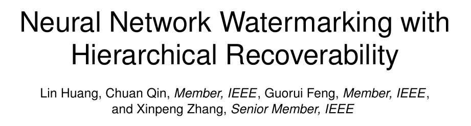

# Neural Network Watermarking with Hierarchical Recoverability



**Lin Huang, Chuan Qin, Guorui Feng, and Xinpeng Zhang**  
*IEEE Transactions on Dependable and Secure Computing*, 22(5), 5077–5089, 2025.  
[Paper](https://doi.org/10.1109/TDSC.2025.3560426)

## Overview

NNWHR embeds authentication and recovery information in the parameters of a neural network. It ranks protected parameters by importance and shares recovery information across parameter groups. This lets the method detect and locate tampering while giving more important parameters a higher priority for recovery.

## Code

| Entry point | Purpose |
| --- | --- |
| [`Score_cal.py`](train_code/Score_cal.py) | Compute and rank parameter importance. |
| [`Main_embedding.py`](train_code/Main_embedding.py) | Embed authentication and recovery information in selected model layers. |
| [`Model_attack.py`](train_code/Model_attack.py) | Apply controlled parameter tampering for evaluation. |
| [`Main_recovery.py`](train_code/Main_recovery.py) | Locate tampered parameters and evaluate hierarchical recovery. |

## Quick start

Prepare the Fashion-MNIST data, ResNet-18 checkpoint and parameter ranking using the [experiment setup](docs/EXPERIMENTS.md). The three commands embed the watermark, simulate parameter tampering, and evaluate recovery.

```bash
python -m pip install -r requirements.txt
cd train_code
python Main_embedding.py
python Model_attack.py
python Main_recovery.py
```

## Citation

Lin Huang, Chuan Qin, Guorui Feng, and Xinpeng Zhang. “Neural Network Watermarking with Hierarchical Recoverability.” *IEEE Transactions on Dependable and Secure Computing*, 22(5), 5077–5089, 2025. [DOI](https://doi.org/10.1109/TDSC.2025.3560426)
